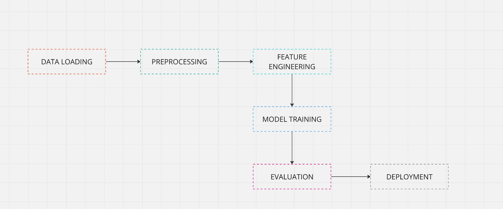

# Movie Review Sentiment Analysis

A scikit-learn pipeline that labels IMDB movie reviews as positive or negative, so a streaming platform can build "Popular" and "Top" sections without reading every review by hand.

## Results

Held-out test set: 8,000 reviews (20% of 40,000, `random_state=34`).

| Metric | Score |
|---|---|
| Accuracy | **88.5%** |
| F1, label 0 | 0.89 |
| F1, label 1 | 0.88 |
| 5-fold CV accuracy on the training split (best grid point) | 88.25% |

The notebook does not report a baseline model, so these numbers are not compared against one.

## Problem

A new movie streaming platform needs to know how viewers rate each film in order to build "Popular" and "Top" sections and recommendations. Reading reviews by hand takes too much time and labor, so the notebook builds an automated pipeline that labels each review as negative or positive.

## Data

- **Source:** [IMDB movie ratings sentiment dataset on Kaggle](https://www.kaggle.com/datasets/yasserh/imdb-movie-ratings-sentiment-analysis)
- **Size:** 40,000 reviews, two columns: `text` and a binary `label`. The notebook describes the classes as balanced.
- **Split:** 80% training (32,000) and 20% test (8,000).
- The CSV is not included in this repo (see How to run).

## Approach

- **Cleaning** (`preprocessing` in the notebook, in this order): remove e-mail-like tokens, replace every non-letter character with a space and collapse whitespace (`punct_cleaning`), run BeautifulSoup `get_text()` (`cleaner`), tokenize with NLTK `word_tokenize` on the lowercased text, keep alphabetic tokens that are not English stop words, lemmatize (WordNet), then Porter-stem. This reduces vocabulary noise for a bag-of-words model.
- **Features:** TF-IDF on unigrams and bigrams (`ngram_range=(1, 2)`), fitted on the training split only.
- **Model:** Multinomial Naive Bayes, tuned with `GridSearchCV` over 16 candidates (`alpha`, `force_alpha`, `fit_prior`) using 5-fold cross-validation. The best candidate was `alpha=1.0`, `fit_prior=False`, `force_alpha=True`.
- **Unused features:** the notebook also computes a VADER compound sentiment score and a review length, but the final model is fitted on the TF-IDF matrix only.



## Repo contents

- `sentiment_analysis.ipynb`: the full pipeline, from loading the data to evaluation.
- `hld.JPG`: high-level system design diagram.
- `README.md`: this file.

## How to run

This project is notebook-only. There are no scripts.

1. Download `movie.csv` from the [Kaggle dataset](https://www.kaggle.com/datasets/yasserh/imdb-movie-ratings-sentiment-analysis) and place it in the repo folder. The notebook reads it with `pd.read_csv('movie.csv')`.
2. Install the dependencies and the NLTK data:

```bash
pip install pandas nltk scikit-learn beautifulsoup4 matplotlib seaborn jupyter
python -m nltk.downloader punkt punkt_tab stopwords wordnet vader_lexicon
```

3. Open and run the notebook:

```bash
jupyter notebook sentiment_analysis.ipynb
```

The notebook itself only downloads `vader_lexicon`, so the other NLTK resources are needed before running it.

## Limitations and next steps

- The model is binary and has no neutral class. Naive Bayes on bag-of-words features struggles with complex language, as the notebook notes.
- HTML tags are not removed. `punct_cleaning` runs before BeautifulSoup, so the tags' letters survive as words and the BeautifulSoup step receives plain text. For example, `<br /><br />` becomes `br br` in the cleaned text. Running BeautifulSoup before `punct_cleaning` would fix this.
- The VADER and length features are computed but not used. No baseline is reported, and the results come from a single 80/20 split with one random seed.
- The notebook's written commentary on the confusion matrix does not match its own classification report, so this README uses only the report figures.
- Next steps: add a neutral class or more labels, try a transformer model, and label new reviews as they arrive.

Coursework for M508B Big Data Analytics.
